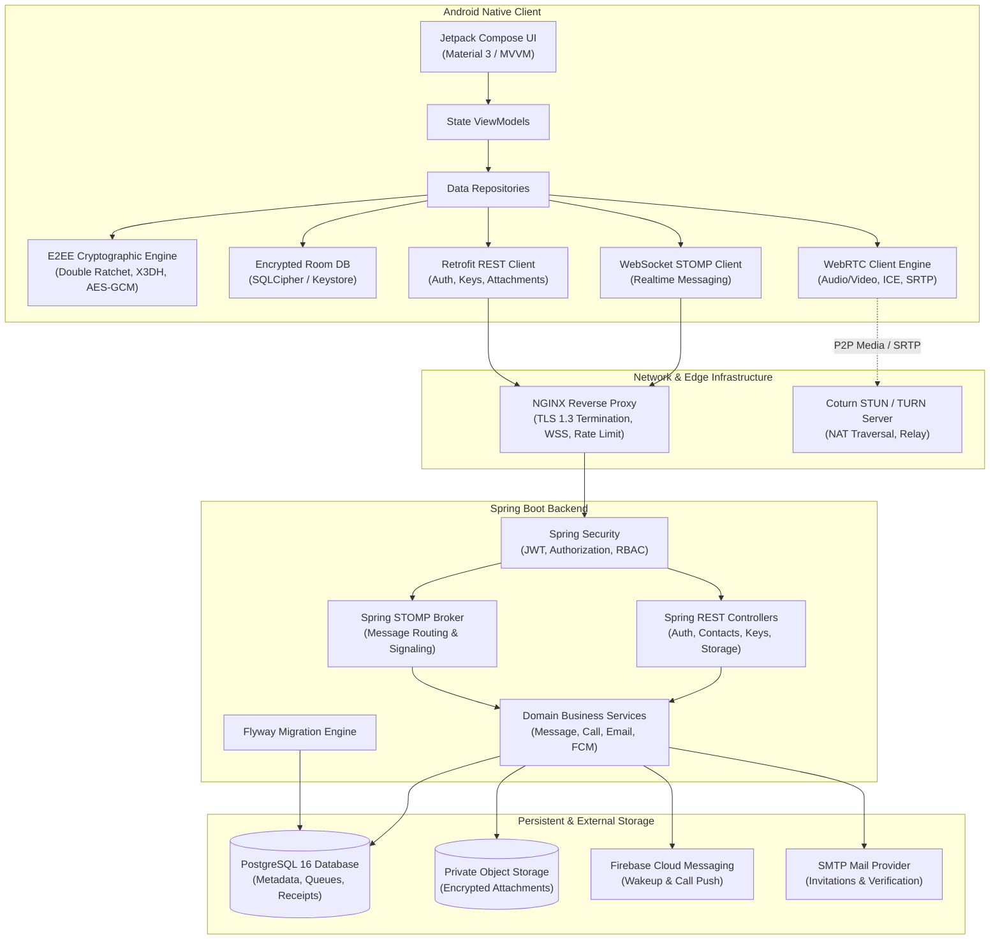
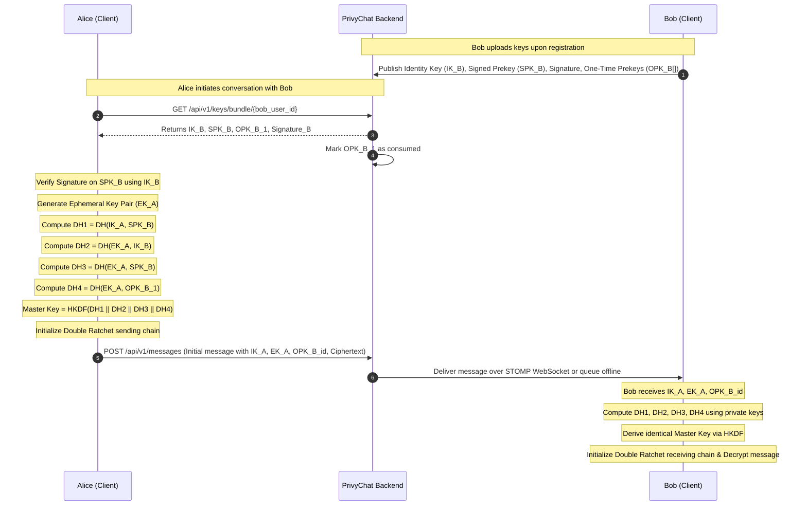
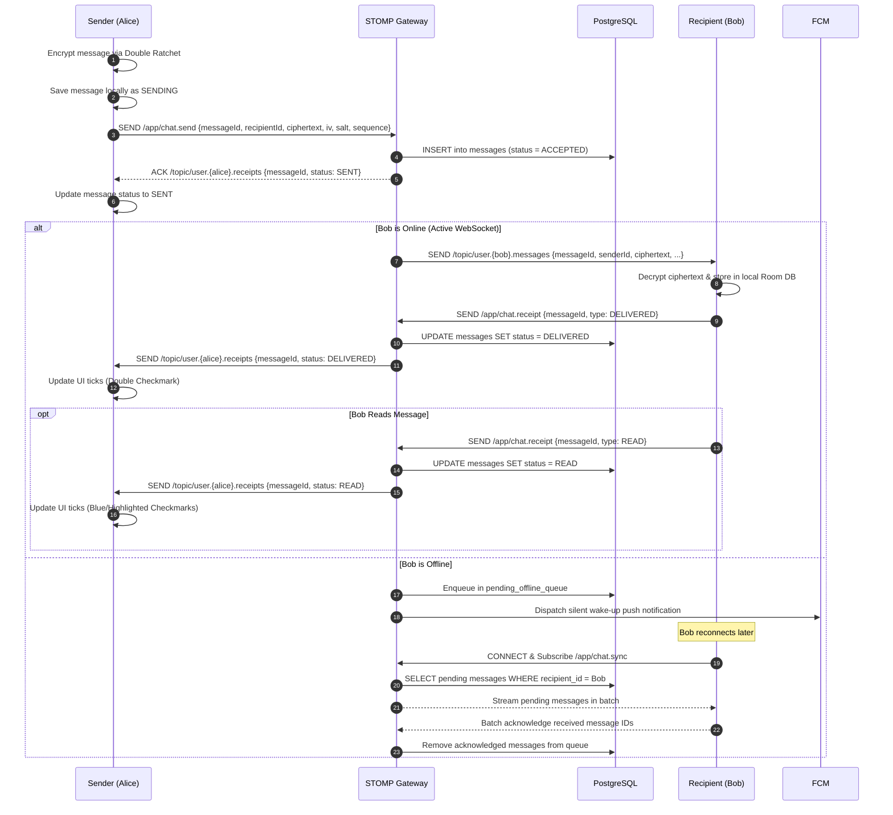
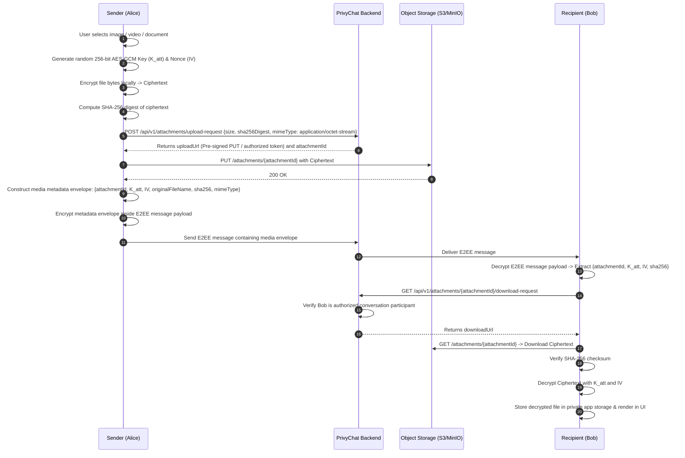
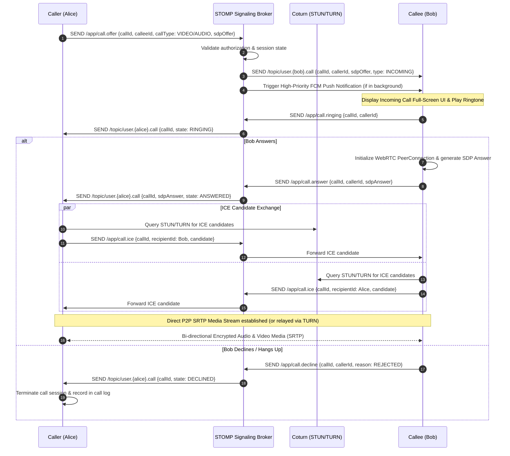

# PrivyChat System Architecture & Data Flows

## 1. High-Level Component Architecture

PrivyChat is structured into distinct, decoupled components designed for low latency, high resilience, and zero trust.

---

## 2. Core Communication & Encryption Flows

### A. Extended Triple Diffie-Hellman (X3DH) Initial Handshake

When User A (Alice) wants to initiate a conversation with User B (Bob) for the first time:

---

### B. Message Delivery & Offline Synchronization Flow

---

### C. Private Media Attachment Sharing Flow

---

### D. WebRTC Audio / Video Calling Flow

