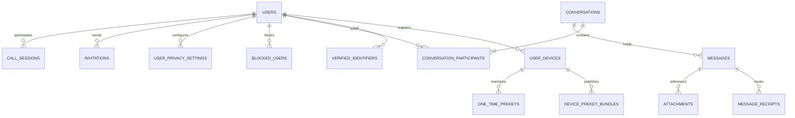

# PrivyChat Database Architecture & Flyway Migrations

## 1. Relational Database Design (PostgreSQL 16)

PrivyChat uses PostgreSQL 16 as its authoritative relational datastore for account identities, device public keys, conversation membership, durable message queues, and delivery receipts.

### Key Database Design Principles
1. **Zero Message Plaintext**: The database never stores plaintext message bodies, contact nicknames, or file decryption keys.
2. **Strict Two-Participant Invariant**: Every row in `conversations` represents an authorized one-to-one dialogue. Unique constraints prevent duplicate dialogues between the same pair of users.
3. **UUID Primary Keys**: All entity IDs are 128-bit version-4 UUIDs generated client-side or server-side, preventing enumeration attacks.
4. **Referential Integrity & Cascading Deletions**: Foreign keys maintain referential consistency; account deletion cascades cleanly according to retention rules.

---

## 2. Entity-Relationship Diagram



---

## 3. Core Database Tables & Schema Definition

### A. `users`
Represents registered accounts.
```sql
CREATE TABLE users (
    id UUID PRIMARY KEY DEFAULT gen_random_uuid(),
    display_name VARCHAR(100) NOT NULL,
    avatar_url VARCHAR(512),
    email VARCHAR(255) NOT NULL UNIQUE,
    phone_number VARCHAR(32) NOT NULL UNIQUE,
    password_hash VARCHAR(255) NOT NULL,
    email_verified BOOLEAN NOT NULL DEFAULT FALSE,
    phone_verified BOOLEAN NOT NULL DEFAULT FALSE,
    status VARCHAR(32) NOT NULL DEFAULT 'ACTIVE', -- ACTIVE, SUSPENDED, DELETED
    created_at TIMESTAMP WITH TIME ZONE NOT NULL DEFAULT CURRENT_TIMESTAMP,
    updated_at TIMESTAMP WITH TIME ZONE NOT NULL DEFAULT CURRENT_TIMESTAMP
);
CREATE INDEX idx_users_email ON users(email);
CREATE INDEX idx_users_phone ON users(phone_number);
```

### B. `user_devices`
Tracks client devices and active sessions for each account.
```sql
CREATE TABLE user_devices (
    id UUID PRIMARY KEY DEFAULT gen_random_uuid(),
    user_id UUID NOT NULL REFERENCES users(id) ON DELETE CASCADE,
    device_label VARCHAR(100) NOT NULL,
    fcm_push_token VARCHAR(512),
    public_identity_key TEXT NOT NULL, -- Curve25519 / Ed25519 Base64
    registration_id INT NOT NULL,
    is_active BOOLEAN NOT NULL DEFAULT TRUE,
    last_seen_at TIMESTAMP WITH TIME ZONE,
    created_at TIMESTAMP WITH TIME ZONE NOT NULL DEFAULT CURRENT_TIMESTAMP,
    CONSTRAINT uq_user_registration UNIQUE (user_id, registration_id)
);
CREATE INDEX idx_devices_user ON user_devices(user_id);
```

### C. `device_prekey_bundles` & `one_time_prekeys`
Stores cryptographic prekeys uploaded by devices for X3DH session establishment.
```sql
CREATE TABLE device_prekey_bundles (
    id UUID PRIMARY KEY DEFAULT gen_random_uuid(),
    device_id UUID NOT NULL REFERENCES user_devices(id) ON DELETE CASCADE,
    signed_prekey_id INT NOT NULL,
    signed_prekey_public TEXT NOT NULL,
    signed_prekey_signature TEXT NOT NULL,
    created_at TIMESTAMP WITH TIME ZONE NOT NULL DEFAULT CURRENT_TIMESTAMP,
    CONSTRAINT uq_device_signed_prekey UNIQUE (device_id, signed_prekey_id)
);

CREATE TABLE one_time_prekeys (
    id UUID PRIMARY KEY DEFAULT gen_random_uuid(),
    device_id UUID NOT NULL REFERENCES user_devices(id) ON DELETE CASCADE,
    key_id INT NOT NULL,
    public_key TEXT NOT NULL,
    consumed BOOLEAN NOT NULL DEFAULT FALSE,
    consumed_at TIMESTAMP WITH TIME ZONE,
    created_at TIMESTAMP WITH TIME ZONE NOT NULL DEFAULT CURRENT_TIMESTAMP,
    CONSTRAINT uq_device_otpk UNIQUE (device_id, key_id)
);
CREATE INDEX idx_otpk_available ON one_time_prekeys(device_id) WHERE NOT consumed;
```

### D. `conversations` & `conversation_participants`
Defines 1-to-1 conversations and validates the two-participant constraint.
```sql
CREATE TABLE conversations (
    id UUID PRIMARY KEY DEFAULT gen_random_uuid(),
    participant1_id UUID NOT NULL REFERENCES users(id) ON DELETE CASCADE,
    participant2_id UUID NOT NULL REFERENCES users(id) ON DELETE CASCADE,
    created_at TIMESTAMP WITH TIME ZONE NOT NULL DEFAULT CURRENT_TIMESTAMP,
    updated_at TIMESTAMP WITH TIME ZONE NOT NULL DEFAULT CURRENT_TIMESTAMP,
    CONSTRAINT chk_different_participants CHECK (participant1_id != participant2_id),
    -- Canonical order to prevent duplicate (A,B) vs (B,A) conversations
    CONSTRAINT uq_canonical_participants UNIQUE (participant1_id, participant2_id)
);

CREATE TABLE conversation_participants (
    id UUID PRIMARY KEY DEFAULT gen_random_uuid(),
    conversation_id UUID NOT NULL REFERENCES conversations(id) ON DELETE CASCADE,
    user_id UUID NOT NULL REFERENCES users(id) ON DELETE CASCADE,
    joined_at TIMESTAMP WITH TIME ZONE NOT NULL DEFAULT CURRENT_TIMESTAMP,
    last_read_message_id UUID,
    is_muted BOOLEAN NOT NULL DEFAULT FALSE,
    CONSTRAINT uq_conversation_member UNIQUE (conversation_id, user_id)
);
CREATE INDEX idx_conv_part_user ON conversation_participants(user_id);
```

### E. `messages`
Durable delivery queue storing end-to-end encrypted ciphertexts.
```sql
CREATE TABLE messages (
    id UUID PRIMARY KEY, -- Client-generated UUID
    conversation_id UUID NOT NULL REFERENCES conversations(id) ON DELETE CASCADE,
    sender_id UUID NOT NULL REFERENCES users(id) ON DELETE CASCADE,
    sender_device_id UUID NOT NULL REFERENCES user_devices(id) ON DELETE SET NULL,
    recipient_id UUID NOT NULL REFERENCES users(id) ON DELETE CASCADE,
    recipient_device_id UUID REFERENCES user_devices(id) ON DELETE SET NULL,
    ciphertext TEXT NOT NULL, -- E2EE Base64 payload
    iv VARCHAR(64) NOT NULL,
    ratchet_public_key TEXT, -- Ephemeral DH Ratchet public key
    sequence_number BIGINT NOT NULL,
    previous_counter INT NOT NULL DEFAULT 0,
    one_time_prekey_id INT,
    status VARCHAR(32) NOT NULL DEFAULT 'ACCEPTED', -- ACCEPTED, DELIVERED, READ, EXPIRED
    is_delivered BOOLEAN NOT NULL DEFAULT FALSE,
    is_read BOOLEAN NOT NULL DEFAULT FALSE,
    delivered_at TIMESTAMP WITH TIME ZONE,
    read_at TIMESTAMP WITH TIME ZONE,
    created_at TIMESTAMP WITH TIME ZONE NOT NULL DEFAULT CURRENT_TIMESTAMP
);
CREATE INDEX idx_messages_conversation ON messages(conversation_id, created_at DESC);
CREATE INDEX idx_messages_pending_delivery ON messages(recipient_id) WHERE NOT is_delivered;
```

### F. `encrypted_attachments`
Tracks metadata for encrypted blobs stored in private S3/MinIO storage.
```sql
CREATE TABLE encrypted_attachments (
    id UUID PRIMARY KEY DEFAULT gen_random_uuid(),
    message_id UUID REFERENCES messages(id) ON DELETE CASCADE,
    uploader_id UUID NOT NULL REFERENCES users(id) ON DELETE CASCADE,
    storage_path VARCHAR(512) NOT NULL,
    file_size_bytes BIGINT NOT NULL,
    sha256_checksum VARCHAR(64) NOT NULL,
    mime_type VARCHAR(128) NOT NULL DEFAULT 'application/octet-stream',
    created_at TIMESTAMP WITH TIME ZONE NOT NULL DEFAULT CURRENT_TIMESTAMP
);
CREATE INDEX idx_attachments_uploader ON encrypted_attachments(uploader_id);
```

### G. `invitations`
Tracks invitation tokens for inviting unregistered contacts.
```sql
CREATE TABLE invitations (
    id UUID PRIMARY KEY DEFAULT gen_random_uuid(),
    inviter_id UUID NOT NULL REFERENCES users(id) ON DELETE CASCADE,
    recipient_email VARCHAR(255) NOT NULL,
    token_hash VARCHAR(255) NOT NULL UNIQUE,
    status VARCHAR(32) NOT NULL DEFAULT 'PENDING', -- PENDING, ACCEPTED, REVOKED, EXPIRED
    expires_at TIMESTAMP WITH TIME ZONE NOT NULL,
    created_at TIMESTAMP WITH TIME ZONE NOT NULL DEFAULT CURRENT_TIMESTAMP
);
CREATE INDEX idx_invitations_token ON invitations(token_hash);
CREATE INDEX idx_invitations_email ON invitations(recipient_email);
```

### H. `call_sessions`
Audit log of WebRTC voice and video calls (metadata only; media is P2P SRTP).
```sql
CREATE TABLE call_sessions (
    id UUID PRIMARY KEY DEFAULT gen_random_uuid(),
    caller_id UUID NOT NULL REFERENCES users(id) ON DELETE CASCADE,
    callee_id UUID NOT NULL REFERENCES users(id) ON DELETE CASCADE,
    call_type VARCHAR(16) NOT NULL, -- AUDIO, VIDEO
    status VARCHAR(32) NOT NULL, -- INITIATED, RINGING, CONNECTED, REJECTED, MISSED, ENDED
    started_at TIMESTAMP WITH TIME ZONE NOT NULL DEFAULT CURRENT_TIMESTAMP,
    ended_at TIMESTAMP WITH TIME ZONE,
    duration_seconds INT DEFAULT 0
);
CREATE INDEX idx_calls_caller ON call_sessions(caller_id);
CREATE INDEX idx_calls_callee ON call_sessions(callee_id);
```

---

## 4. Retention & Account Deletion Policy

1. **Delivered Messages**: Once a message has been delivered to all registered devices and acknowledged as READ, messages in the backend database are subject to automated pruning (default 30 days) since authoritative copies reside in clients' encrypted local Room databases.
2. **Account Deletion (Right to Be Forgotten)**:
   - When a user deletes their account via `DELETE /api/v1/account`:
   - All prekeys, devices, active sessions, and verification tokens are deleted immediately (`CASCADE`).
   - The user's rows in `conversations` and `messages` are sanitized or removed.
   - S3 attachments uploaded by the user are scheduled for asynchronous physical deletion.

