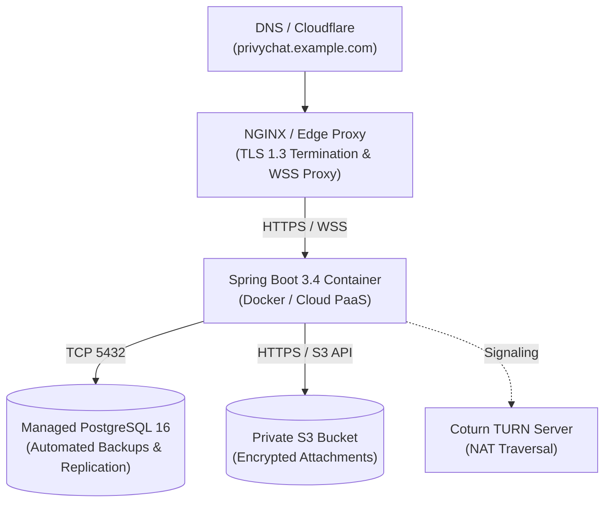

# PrivyChat Production Deployment Guide

## 1. Production Topology



---

## 2. Docker Production Deployment

### Building the Production Docker Image
```powershell
docker build -t privychat-backend:1.0.0 -f infrastructure/docker/Dockerfile.backend .
```

### Running with Docker Compose
```powershell
cd infrastructure/docker
docker compose -f docker-compose.prod.yml up -d
```

---

## 3. Cloud Deployment Targets

### Option A: Railway / Render / Fly.io / AWS ECS
1. Provision Managed PostgreSQL and MinIO/S3 bucket.
2. Deploy Docker image from `Dockerfile.backend`.
3. Set production environment variables (from `.env.example`).
4. Configure domain and SSL certificates via automated Let's Encrypt.

### Option B: Supabase (Managed PostgreSQL)
1. In Supabase project settings, copy PostgreSQL connection pooler URI (`jdbc:postgresql://aws-0-...pooler.supabase.com:6543/postgres?sslmode=require`).
2. Supply as `DATABASE_URL` to Spring Boot.
3. Flyway migrations will automatically execute on boot to create all PrivyChat tables.

