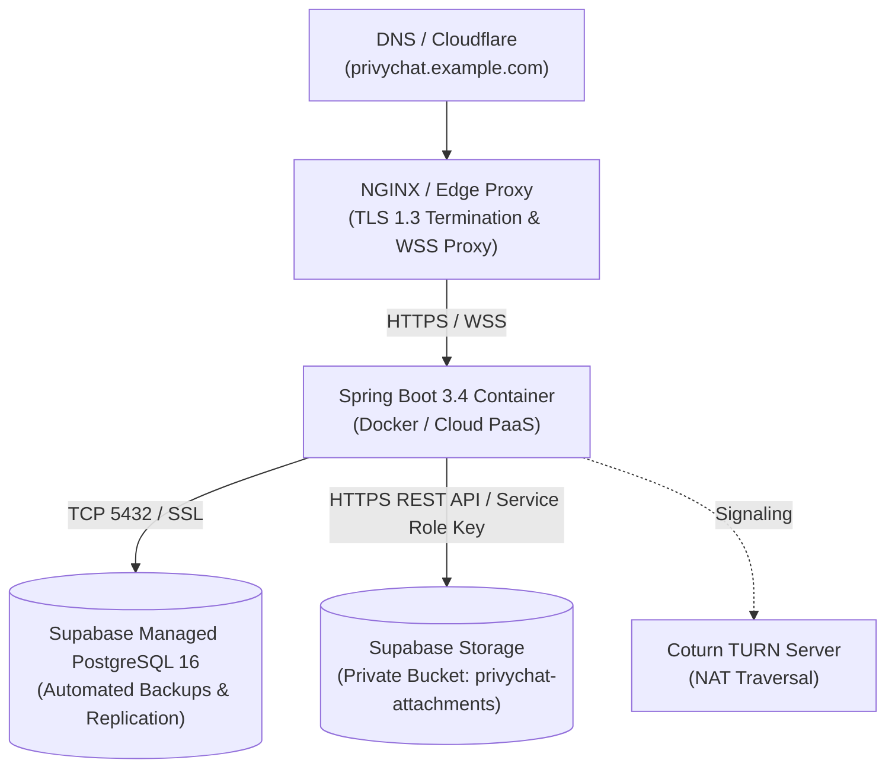

# PrivyChat Production Deployment Guide

## 1. Production Topology



---

## 2. Supabase Cloud Configuration (Database + Storage)

PrivyChat uses Supabase for both its managed PostgreSQL 16 database and private encrypted attachment storage:

### A. Database (PostgreSQL 16)
1. In your Supabase Dashboard $\to$ **Project Settings** $\to$ **Database** $\to$ **Connection string** $\to$ **JDBC**.
2. Set in `.env`:
   ```properties
   DATABASE_URL=jdbc:postgresql://aws-0-eu-west-2.pooler.supabase.com:5432/postgres?sslmode=require
   DATABASE_USERNAME=postgres.<PROJECT_REF>
   DATABASE_PASSWORD=<YOUR_PASSWORD>
   ```
3. Flyway migrations (`V1__init_schema.sql`, `V2__indexes_and_constraints.sql`, `V3__add_conversation_to_attachments.sql`) apply automatically on application startup.

### B. Supabase Storage (Private Encrypted Attachments)
1. In your Supabase Dashboard $\to$ **Project Settings** $\to$ **API**:
   - Copy **Project URL** (e.g. `https://<PROJECT_REF>.supabase.co`).
   - Copy **`service_role` secret key** (revealed under Project API keys). *Never share or expose this key to Android clients.*
2. Configure in `.env`:
   ```properties
   STORAGE_TYPE=SUPABASE
   SUPABASE_URL=https://<PROJECT_REF>.supabase.co
   SUPABASE_SERVICE_ROLE_KEY=<YOUR_SERVICE_ROLE_SECRET_KEY>
   SUPABASE_BUCKET_NAME=privychat-attachments
   SUPABASE_SIGNED_URL_EXPIRATION=300
   ```
3. **Automatic Bucket Creation**: When the backend starts, `SupabaseStorageService` checks if `privychat-attachments` exists; if not, it automatically creates the bucket with `public=false` and a 50MB file size limit.
4. **Manual Creation (Optional via Console)**: In Supabase Dashboard $\to$ **Storage** $\to$ **New bucket** $\to$ Name: `privychat-attachments`, Toggle **Public bucket** to `OFF` (Private).

---

## 3. Supabase Free Plan Limits & Quota Monitoring

| Metric | Free Plan Limit | PrivyChat Enforcement & Optimization |
| :--- | :--- | :--- |
| **Total Storage** | **1 GB** free | The backend validates file sizes and enforces a 50MB per-file ceiling. Attachments are cleaned up via authorized deletion. |
| **Bandwidth (Egress)** | **2 GB / month** | Downloads are proxied/signed strictly on-demand. Thumbnails and previews are sent in the initial E2EE payload to prevent unnecessary downloads. |
| **Max File Upload Size** | **50 MB** per file | Verified both on Android before encryption and on backend via `AttachmentStorageService` before storage transmission. |
| **Private Buckets** | **Unlimited** | `privychat-attachments` is strictly private. All accesses require backend authorization. |

### Monitoring Quotas in Supabase
- Track usage in real time via **Supabase Dashboard $\to$ Organization Settings $\to$ Usage $\to$ Storage**.
- Set up usage alerts at 80% capacity (800 MB) to review storage growth or configure auto-pruning policies.

---

## 4. Docker Production Deployment

### Building the Production Docker Image
```powershell
docker build -t privychat-backend:1.0.0 -f infrastructure/docker/Dockerfile.backend .
```

### Running with Docker Compose
```powershell
cd infrastructure/docker
docker compose up -d
```
> **Note**: MinIO is not required when Supabase Storage is configured in `.env`.

---

## 5. Security Checklist
- [x] Client encrypts raw files locally with AES-256-GCM before upload.
- [x] Server and Supabase Storage store only encrypted ciphertext.
- [x] Decryption keys ($K_{att}$) are transmitted exclusively inside the E2EE Double Ratchet message envelope.
- [x] Supabase `service_role` key is held exclusively by the Spring Boot backend.
- [x] Every upload, download, and deletion is authorized against conversation participants.
- [x] Signed download URLs have a short 300-second expiration.
