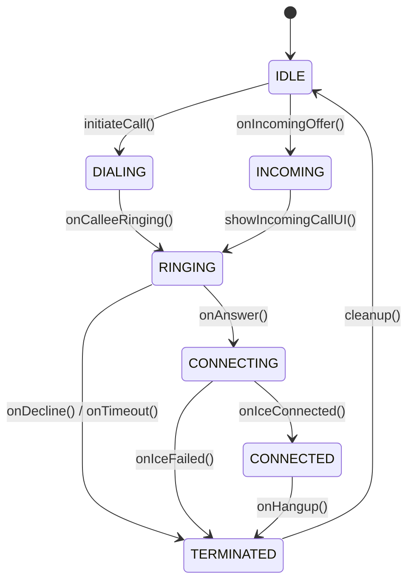

# PrivyChat WebRTC Voice & Video Calling Setup

## 1. Overview & Media Security Architecture

PrivyChat delivers real-time one-to-one voice and video calling using **WebRTC**:
- **Transport Security**: Media packets are encrypted end-to-end via **SRTP** (Secure Real-time Transport Protocol) with keys negotiated over DTLS 1.2 / 1.3.
- **Signaling**: STOMP over WebSocket is used for SDP Offer/Answer exchanges and dynamic ICE candidate routing.
- **NAT Traversal**: Uses Google STUN for direct P2P connections and Coturn TURN for symmetric NAT fallback. The TURN relay cannot decrypt SRTP media packets.

---

## 2. STUN / TURN Server Configuration (Coturn)

A turnkey Coturn configuration is provided in `infrastructure/coturn/turnserver.conf`:

```conf
# Listening ports
listening-port=3478
tls-listening-port=5349

# Relay IP / Interfaces
realm=turn.privychat.example.com
fingerprint
lt-cred-mech
use-auth-secret
static-auth-secret=your_turn_shared_secret_here

# Security restrictions
no-tcp-relay
no-multicast-peers
denied-peer-ip=10.0.0.0-10.255.255.255
denied-peer-ip=172.16.0.0-172.31.255.255
denied-peer-ip=192.168.0.0-192.168.255.255
```

---

## 3. WebRTC Call States in Android Client



---

## 4. Android Foreground Call Service & Audio Routing

- When an active call starts, `CallService` launches as a foreground service with `foregroundServiceType="microphone|camera|phoneCall"`.
- Manages audio focus using `AudioManager` and `AudioAttributes.USAGE_VOICE_COMMUNICATION`.
- Audio output switcher toggles dynamically between:
  - Built-in Speakerphone
  - Earpiece receiver
  - Connected Bluetooth SCO headset

